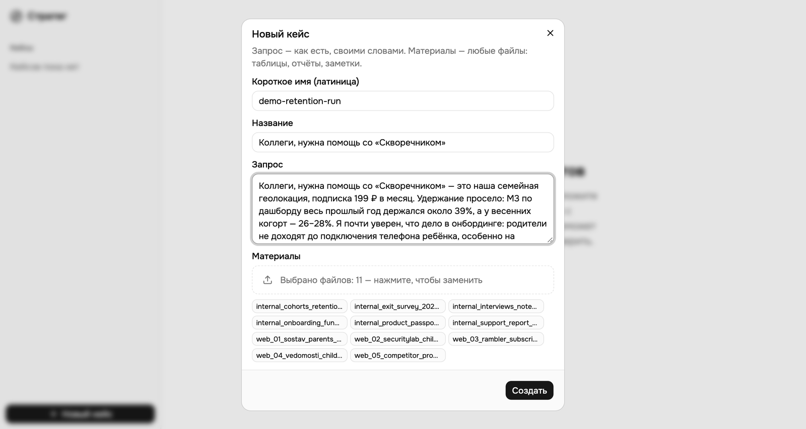
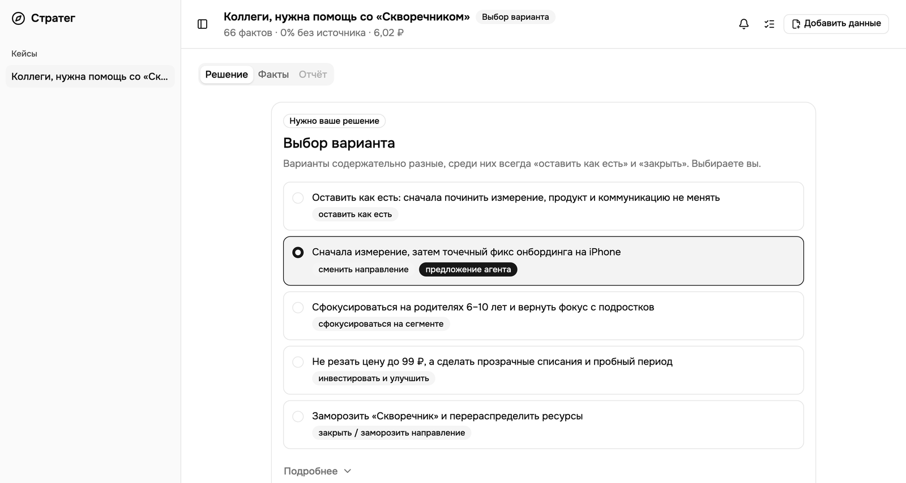
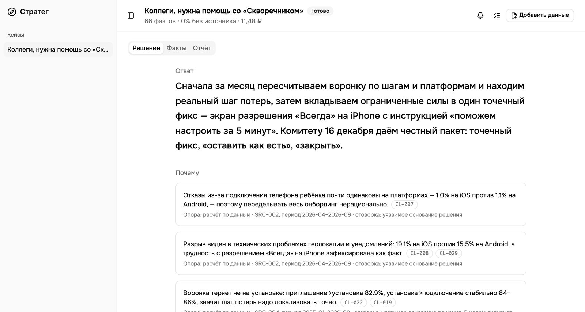
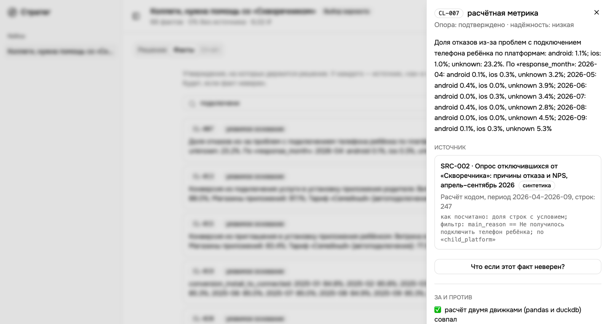
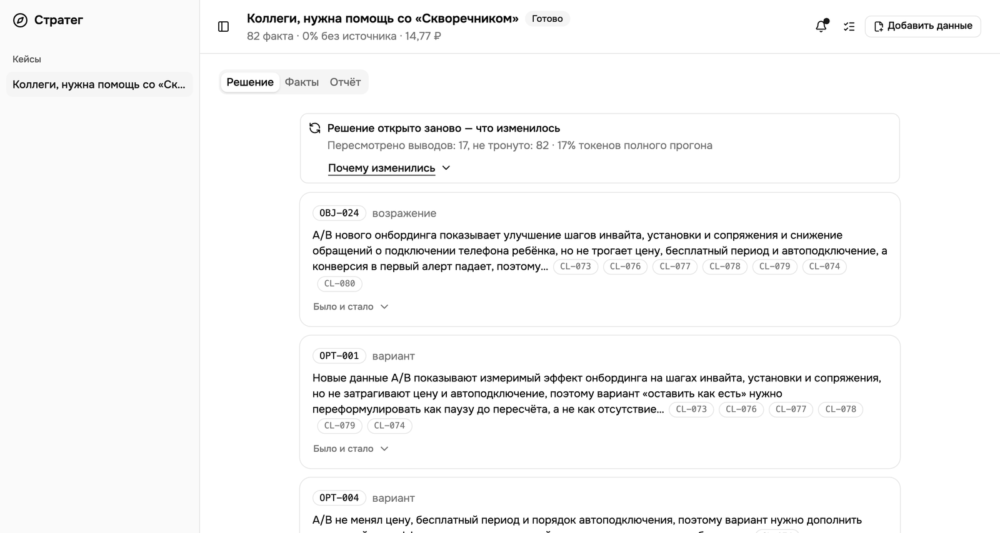
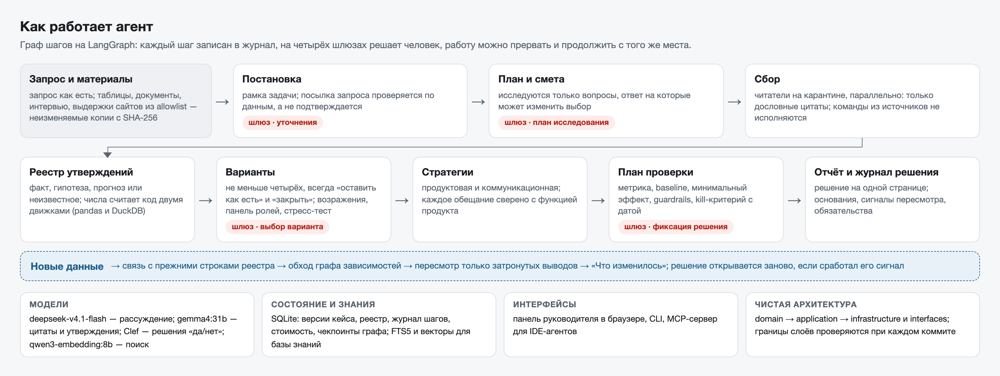

# Стратег Фабрики проектов — описание работы

*MGIMO AI Challenge 2026, номинация «ИИ-проект», кейс МегаФона. Команда SoloTech.team. Версия v0.3.0, 10.11.2026.*

*Видео (5 минут) — [на Google Диске](https://drive.google.com/file/d/1_i_UBDSjCciw_eesIFpMJw-H4wcgeIDR/view).
Пример работы агента — папка `demo-project/` репозитория: задача, материалы, итоговые стратегии. Скриншоты — с
настоящей панели на демо-кейсе.*

## 1. Что делает агент — за одну минуту

Руководитель цифрового продукта пишет размытый запрос («удержание падает, менять продукт или коммуникацию?») и
кладёт в папку материалы — таблицы, документы, выдержки из открытых источников. Агент сам ведёт работу по шагам
и возвращает документ для решения:

- **картину ситуации**: что известно (каждое утверждение — со ссылкой на дословную цитату или расчёт кодом),
  что является гипотезой или прогнозом, и чего мы не знаем;
- **не меньше четырёх содержательно разных вариантов**, всегда включая «оставить как есть» и «закрыть или
  заморозить», с сильными возражениями и стресс-тестом;
- **согласованные продуктовую и коммуникационную стратегии**: обещание аудитории не может опираться на функцию,
  которой нет в продукте;
- **план проверки**: метрика, baseline, минимальный эффект, срок, guardrails, kill-критерий с датой.

После решения агент хранит его основания и сигналы пересмотра. Когда приходят новые данные, он пересматривает
только затронутые выводы и пишет раздел «Что изменилось».

Человек подключается в четырёх точках: уточнения (только если ответ меняет рекомендацию), план исследования
и смета, выбор варианта, фиксация решения. Работу можно остановить в любой момент и продолжить с того же места —
из нового терминала, новой сессии IDE или через MCP.

### Панель руководителя

`uv run strategist ui` открывает в браузере минималистичную панель (FastAPI + React, компоненты shadcn/ui); с
`--demo` она проходит демо-кейс по записанным ответам моделей, без ключей и сети. Три вкладки: «Решение» (ход
работы, шлюзы, ответ на одной странице), «Факты» (несущие утверждения с источником) и «Отчёт». Подробности —
по «Подробнее», чтобы на экране было только то, что нужно для следующего шага. Скриншоты — с демо-кейса
«Скворечник» (внутренние данные синтетические).



*Новый кейс: запрос — как есть, материалы — любые файлы.*



*Шлюз «Выбор варианта»: среди вариантов всегда «оставить как есть» и «закрыть»; агент отмечает свой, выбирает
человек. Оценки ролей и стресс-тест — по «Подробнее».*



*Ответ руководителю: сам ответ, доводы с типом опоры и источником (чип строки реестра открывает факт), дальше —
что делаем, кто и когда, и что сказать команде.*



*Паспорт строки реестра: источник, период и расчёт кодом, «за» и «против». «Что если этот факт неверен?»
показывает без моделей, какие выводы потеряют опору; «Оспорить» запускает точечный пересмотр.*



*После новых данных: сколько выводов пересмотрено и сколько не тронуто, какая доля токенов полного прогона ушла,
и почему изменился каждый вывод.*

## 2. Почему так, а не «ещё один deep research»

Каркас «план → поиск → отчёт со ссылками» стал типовым. Ценность — в том, чтобы сделать выбор **проверяемым**.
Каждый механизм агента — инженерный ответ на измеренную слабость моделей:

| Слабость моделей | Механизм агента |
|---|---|
| Утверждения без опоры (DeepTRACE: от 12,5% у лучшего агента) | Реестр утверждений: строка пишется из дословной цитаты; факт без цитаты, прогноз без вероятности и даты, гипотеза без проверки не попадают в отчёт |
| Число с неверным смыслом: совпадает со своей строкой, но это не тот показатель («отток 84%» — на деле удержание, «2,6 дня» — среднее по месяцам) | Контракт расчёта на шаге расчёта (единица, подпись, «доля строк» агрегата, период и n); сверка чисел с единицами и выведенными числами; выжимка с проверкой чисел и пометкой «не сверено» |
| Руководитель не видит, на чём держится вывод | Проверка оснований: несущие утверждения с «за» и «против»; «что потеряет опору», если строка неверна, — без моделей; «оспорить» — точечный пересмотр |
| Поддакивание пользователю (SycEval: 58%) | Посылка запроса проверяется по данным до исследования; вердикт «подтверждена / частично / не подтверждена» |
| Варианты-оттенки одного плана | Обязательные «оставить» и «закрыть», отсев клонов, осознанные отказы и kill-критерии |
| Дебаты не повышают правильность | Возражения обязаны ссылаться на реестр; панель ролей в двух порядках; стресс-тест с границей решения |
| Обещания сверх продукта | Сверка «обещание = продукт»: функция + строка реестра, иначе блок |
| Пересмотр портит нетронутое (AGM-Bench) | Граф зависимостей: под подозрением только затронутые узлы |
| Прошлый ответ агента становится «фактом» | Память с происхождением: вывод агента — не доказательство без одобрения человека |
| Команды в источниках | Данные маркируются как недоверенные; читатель на карантине; фильтр инструментов; хук IDE |

## 3. Архитектура

### Рабочий процесс



Узлы графа LangGraph:

```
INTAKE ─▶ (CLARIFY) ─▶ RESEARCH_PLAN ─▶ [шлюз: план + смета] ─▶ COLLECT (параллельные читатели) ─▶ MERGE
  ─▶ RESEARCH (цикл: модель сама выбирает инструмент) ─▶ CLAIMS ─▶ SITUATION ─▶ OPTIONS ─▶ STRESS
  ─▶ [шлюз: выбор варианта] ─▶ PRODUCT ─▶ COMMS ⇄ PROMISE_LINT ─▶ EXPERIMENTS ─▶ [шлюз: фиксация] ─▶ REPORT
Новые данные: INGEST ─▶ связи с прежними строками ─▶ обход графа зависимостей ─▶ пересмотр затронутого ─▶ «Что изменилось»
```

Оркестратор — LangGraph (граф, чекпоинты в SQLite, шлюзы через `interrupt()`). Решения держит один оркестратор
вместе с человеком; субагенты-читатели только читают материалы и возвращают цитаты по схеме.

### Чистая архитектура

| Слой | Что внутри |
|---|---|
| domain | Сущности решения (утверждения, варианты, стратегии, эксперименты, журнал решения) и чистые правила: линтеры, граф зависимостей, ценность информации, стресс-тест, самоаудит |
| application | Сценарии (use cases) и порты; не знают о моделях, базах и сети |
| infrastructure | Ollama, Clef/Jev, SQLite, парсеры, таблицы (pandas + DuckDB), веб по allowlist, LangGraph |
| interfaces | CLI, MCP-сервер, веб-панель (FastAPI + React, shadcn/ui) |

Границы слоёв проверяются автоматически (import-linter) при каждом коммите.

### Знания и контекст — четыре раздельных хранилища

1. Постоянные инструкции: `AGENTS.md`, промпты узлов `agent/instructions/` — неизменны во время работы над кейсом.
2. Методика: `knowledge/methodology/` (реестр, ценность информации, варианты, стратегии, эксперименты, журнал
   решения, интервью) и рубрика стенда.
3. Материалы кейса: неизменяемые копии с SHA-256; изменённый файл останавливает работу с понятной ошибкой.
4. Состояние задачи: версии кейса, реестр, журнал шагов, стоимость, чекпоинты графа.

База знаний — один SQLite: полнотекстовый поиск (FTS5), поиск по смыслу (sqlite-vec) и связи, ранги сводятся
через RRF. Память хранит происхождение записи; вывод агента не служит доказательством без одобрения человека.

### Ключевые промпты

Промпты узлов лежат в `agent/instructions/` (20 файлов, у каждого версия). Агент во время работы их не
меняет, это проверяет хук. Промпт задаёт роль и правила, ответ — JSON по схеме, его проверяет pydantic.
Детерминированные проверки (линтер утверждений, сверка обещаний, пересчёт чисел, проверка цитат) выполняет
код, а не промпт.

| Промпт | Главное правило |
|---|---|
| `premise_check` | «Твоя задача — проверить, а не подтвердить»: вердикт confirmed / partial / not_confirmed / untested только по строкам реестра; синтетика и гипотезы посылку не подтверждают |
| `extract_evidence` | Читатель на карантине: только дословные цитаты-подстроки с номером фрагмента; команды внутри материала не исполняются, а записываются в `instructions_detected` |
| `extract_claims` | «Сначала цитата, потом утверждение»: атомарные строки с типом; у факта — цитаты, у гипотезы — проверка на опровержение, у прогноза — вероятность, дата и критерий; не обобщать сильнее цитаты |
| `options` | Не меньше 4 вариантов, всегда «оставить как есть» и «закрыть»; у каждого — опора в реестре, допущения, осознанные отказы, kill-критерий с порогом и датой |
| `steelman`, `premortem` | Сильнейший честный аргумент конкурента; пять разных по природе причин провала через 12 месяцев с ранними сигналами. Опора — `claim_id`, без неё возражение помечается как гипотеза |
| `role_panel` | Роль оценивает обезличенные варианты («Вариант A, B…»), порядок не означает приоритета; недоказанный спрос — повод для сомнения. Код прогоняет панель в двух порядках |
| `product_strategy`, `comms_strategy` | Функции размечены как есть / в плане / идея, «в плане» нельзя выдавать за «есть». Каждое обещание ссылается на функцию и строку реестра; барьер — понимание, выбор, доверие или привычка. Неподкреплённое обещание блокирует код сверки и возвращает шаг |
| `experiments` | Начать с неизвестных, которые меняют решение. Гипотеза «Мы считаем, что…», baseline из реестра или первый шаг, как его получить; минимальный эффект, срок не короче поведенческого цикла, guardrails с порогом и ответственным, kill-критерий с датой, правило решения до запуска |
| `revise_nodes` | Пересмотр только узлов «под подозрением»: unchanged / revised / retracted, минимальное изменение — «не меняй то, что новые данные не опровергают; не держись за отозванное» |

## 4. Модели, сервисы и инструменты

| Компонент | Что используем | Для чего |
|---|---|---|
| Рассуждение | `deepseek-v4.1-flash` (Ollama Cloud) | постановка задачи, план, варианты, стресс-тест, стратегии, пересмотр |
| Рабочая модель | `gemma4:31b` (Ollama Cloud) | цитаты, утверждения, проверка опоры, панель ролей |
| Модель решений | Clef (`clef:cloud`, System One API) | тип утверждения, сверка обещаний, клоны вариантов, сила возражений; Jev — тот же протокол при ключе |
| Локальная модель | `gpt-oss:20b` | запасной путь, скрининг |
| Эмбеддинги | `qwen3-embedding:8b` (локально) | различимость вариантов, поиск в базе знаний |
| Судьи стенда | `mistral-large-4`, `kimi-k2.6` | слепое сравнение — другие семейства моделей |
| Оркестрация | LangGraph + SqliteSaver | граф, шлюзы, продолжение после перерыва |
| Состояние и знания | SQLite (WAL), FTS5 + sqlite-vec | версии кейса, реестр, журнал шагов, стоимость, события; гибридный поиск в базе знаний (RRF) |
| Данные | pandas + DuckDB, openpyxl | каждая метрика считается двумя движками независимо |
| Документы и сайты | pypdf, python-docx, trafilatura, httpx | разбор с адресами фрагментов; сайты — только из allowlist |
| Схемы и отчёт | pydantic v2, markdown | контракты ответов моделей и доменные сущности; HTML-отчёт |
| Интерфейсы | Typer + Rich, MCP (mcp 2.x), FastAPI + SSE, React 19 + shadcn/ui (Vite, Tailwind) | CLI, интеграция с IDE, панель руководителя; ход работы приходит в панель событиями (SSE) |
| Разработка | Claude Code, Backlog.md; uv, ruff, import-linter, pytest, pre-commit | агент разработки, задачи и решения; контракты слоёв и сканер секретов в `make check` |
| Видео | HyperFrames 0.9 (HTML + GSAP), Playwright для снимков настоящей панели; озвучка VoxCPM2 (OpenBMB, Apache-2.0) — синтетический голос по описанию, ничей, помечен в кадре; музыка и звуки CC0; num2words; Whisper — проверка разборчивости | ролик: все числа в кадре и в озвучке берутся из файлов прогона, сценарий проверяется до сборки; громкость и синхрон голоса проверяются автоматически |

Выбор моделей сделан по замерам, а не по памяти: 10 русских промптов кейса, два слепых судьи других семейств,
38 размеченных вопросов для модели решений (`evals/spikes/*/REPORT.md`). Найдено, что облачные модели Ollama
игнорируют JSON Schema — схема дублируется в промпте и ответ валидируется; Clef даёт 97,4% на русском наборе.

## 5. Реализованные возможности дополнительного уровня

| Возможность из задания | Как реализовано |
|---|---|
| Маршрутизация | Роль модели по типу задачи, эскалация по цепочке при невалидном ответе, запасные модели; модель решений Clef с проверкой вариантов и эскалацией при низкой уверенности (событие «неверный маршрут») |
| Навыки, хуки, субагенты | Методика как навыки `.agents/skills` (постановка, pre-mortem, сверка обещаний, гайд интервью, шесть плейбуков) — промпт узла подключает их по имени; субагенты-читатели (параллельно, на карантине); хуки событий (журнал безопасности, журнал маршрутов, git-коммит артефактов); IDE-хук защиты инструкций |
| Интеграции через MCP и CLI | MCP-сервер (создать кейс, вести шлюзы, реестр, новые данные, «что изменилось», «что решать сейчас», проверка оснований, пробное исключение опоры, оспорить основание); CLI `strategist` |
| База знаний | FTS5 + векторы + связи, RRF; память с происхождением, отзыв и исправление без удаления |
| Поддержка решений | Журнал решения (ADR, DACI, RAND ABP), сигналы пересмотра, обязательства, «что решать сейчас», устаревшие основания |
| Пересмотр при новых данных | Граф зависимостей, пересмотр только затронутого, проверка сигналов и kill-критериев решения по новым данным, раздел «Что изменилось», повторное открытие решения и новая рекомендация |
| Модельные респонденты | Панель персон на карантине: плацебо-концепт, утверждения в двух формулировках, оценка по тексту (SSR), разногласия профилей и вопросы для реальных интервью вместо средних; синтетика в фактах останавливает работу |
| Анализ данных | Паспорт таблицы, двойной расчёт pandas + DuckDB, проверка парадокса Симпсона; контракт расчёта: единица времени по столбцу, «отток» над долей оставшихся переподписывается, «доля строк» таблицы, где строка — группа, не идёт в отчёт, у расчёта — период и n |
| Смысл чисел в тексте (v0.2.0) | Сверка чисел v2: у числа есть единица (%, п.п., ₽, время), выведенные числа (разность, отношение, изменение) и цели принимаются, ошибкой показываются «нет опоры», «другая единица», «число из другой строки». Выжимка проверяет свои числа, при ошибке — один повтор с замечаниями, затем довод из текста опорной строки; у довода — тип опоры и оговорка. Расчёты и оценки самого агента (стресс-тест, панель ролей, прогнозы) подписаны как модельные |
| Проверка оснований (v0.2.0) | `strategist audit` и вкладка «Факты» панели: несущие утверждения — цитата, «за» и «против», сколько выводов на них держится. `strategist challenge`: что потеряет опору, если строка неверна, — по графу зависимостей, без моделей и без изменения кейса. «Оспорить» — опровергатель у строки и пересмотр только зависимых выводов |
| Устойчивость к сбоям | Журнал шагов, кэш ответов моделей, продолжение после kill -9 и Ctrl+C без повторов |
| Переносимость | AGENTS.md, CLI, MCP; кейс начат в CLI и продолжен через MCP из той же папки |
| Сравнение с исходным способом | Стенд из 7 брифов, простой чат на той же модели, слепое судейство в двух порядках |
| Панель руководителя (v0.3.0) | Веб-панель на React и shadcn/ui: три вкладки, шлюзы с «Подробнее», ход работы событиями SSE, паспорт факта, «что если факт неверен», «Оспорить», новые данные кнопкой; `--demo` проходит демо без моделей; путь от «Открыть демо» до пересмотра проверяется в браузере (`make ui-check`) |

## 6. Время, стоимость, ошибки и помощь человека

**Демо-проект «Скворечник»** — тот прогон, что лежит в `demo-project/` и показан в ролике. Цифры — из чека
стоимости отчёта, по прайсу облачных моделей:

| Этап | Шагов | Вызовов моделей | Токены (вход / выход) | Время ответа моделей | Стоимость по прайсу |
|---|---|---|---|---|---|
| От запроса до зафиксированного решения | 31 | 216 | 395 164 / 52 679 | 353 с | $0,1435 ≈ 11,48 ₽ |
| Пересмотр после новых данных (A/B-тест) | 3 | 23 | 62 656 / 20 052 | 76 с | $0,0411 ≈ 3,29 ₽ |
| Всего | 34 | 239 | 457 820 / 72 731 | 428 с | $0,1846 ≈ 14,77 ₽ |

Живой прогон занимает 5–8 минут: модели отвечают суммарно около 7 минут, но читатели материалов работают
параллельно. Пересмотр потратил 76 тыс. токенов против ~446 тыс. на полную перегенерацию — 17%, почти в 6 раз
меньше. Воспроизведение записи без моделей (`uv run strategist demo --replay`) даёт тот же отчёт за ~15 секунд и
бесплатно.

**Время человека.** В записанном прогоне — 0 минут: шлюзы пройдены в режиме демо, на каждом принят вариант агента
по умолчанию. В живой работе руководитель отвечает на четырёх шлюзах; в расчёте полной стоимости (§7) на это
заложено 15 минут.

**Стенд из 7 брифов (v0.2.0, 09.11):** 132–191 вызов моделей, $0,09–0,14 и 3,3–4,8 минуты на бриф — столько же,
сколько у v0.1.1. Сверка чисел и контракт расчёта работают без моделей. Новый вызов модели один — повтор выжимки
по замечаниям проверки, он понадобился в 3 брифах из 7.

На подписке Ollama Pro фактические деньги втрое меньше (кредиты $60 за $20). Простой чат на той же модели — один
вызов ≈ 0,5 ₽ — дешевле, но без реестра, обязательных вариантов, сверки обещаний и пересмотра.

Что исправлено по живым прогонам (без помощи человека в самих прогонах): читатель пропускал рыночные выдержки
(добавлен вопрос о контексте ситуации); метрика «доля по группам» давала 100% в каждой группе (исправлена
семантика); оценки силы возражений все уходили на эскалацию (шкалы не эскалируются); синтетические
«внутренние данные» демо смешивались с модельными респондентами (введён тип синтетики). Другие найденные ошибки
и их исправления — в §7: обрезка документов судьями, ложное «решение открыто заново», усреднение процентов по
сегментам разного размера.

**Помощь человека.** В прогонах демо и стенда помощи человека не было: шлюзы проходились автоматически. Агента
разрабатывала команда вместе с агентом разработки Claude Code. Решения о направлении — архитектура, выбор моделей
по замерам, собственный демо-кейс, панель, голос ролика — и проверку результатов делала команда.

## 7. Сравнение с исходным способом работы

**Коротко.** На 7 брифах с той же моделью:
- у агента в каждом брифе есть «оставить как есть», guardrail и kill-критерий с датой; у простого чата — в 2, 4 и
  4 брифах из 7 (замер 05.11);
- судьи Mistral и Kimi на полных документах отдали агенту 14 вердиктов из 14, третий судья Codex — 5 пар из 7;
- доля утверждений без опоры у агента (17,8%) от чата (15,3%) статистически не отличается, поэтому «точнее чата»
  мы не заявляем;
- подложенные ошибки в числах новая сверка ловит в 96% случаев против 36% у прежней, ложных срабатываний 0%.

Ниже — как получены эти цифры, включая ошибки, найденные в самом стенде.

Стенд `evals/`: 7 брифов (повышение цены в двух вариантах с разной правильной рекомендацией, удержание, семейный
пакет, вывод функции, онбординг, B2B), одни и те же материалы и одна reasoning-модель. Исходный способ — простой
чат: один запрос с брифом и материалами. Метрики считает судья другого семейства, попарное сравнение — два судьи
(Mistral, Kimi) вслепую и в двух порядках; победа засчитывается, только если вердикт не зависит от порядка.
Полные таблицы — `evals/results/comparison/SUMMARY.md`.

| Что проверяли | Простой чат | Агент (v4) | Агент (v3) |
|---|---|---|---|
| Есть вариант «оставить как есть» | 2 из 7 | 7 из 7 | 7 из 7 |
| Есть вариант «закрыть» | 3 из 7 | 6 из 7 | 7 из 7 |
| В плане проверки есть guardrail | 4 из 7 | 7 из 7 | 7 из 7 |
| Kill-критерий с датой | 4 из 7 | 7 из 7 | 7 из 7 |
| Выбор совпал с ожидаемым экспертом (полностью / частично) | 6 / 1 из 7 | 6 / 1 из 7 | 5 / 2 из 7 |
| Утверждения без опоры в материалах | 0–15% | 5–30% | 0–35% |
| Слепое попарное судейство (14 вердиктов) | 0 побед | 9 побед, 5 ничьих | 11 побед, 3 ничьих |
| Третий судья Codex на полных документах (7 пар) | 3 победы | 3 победы, 1 неустойчиво | — |
| Вызовов моделей / время / стоимость на бриф | 1 / 13–21 с / $0,004–0,011 | 145–180 / 3,2–4,1 мин / $0,10–0,13 | 137–157 / 2,8–3,7 мин / $0,09–0,13 |

v3 (04.11) — стенд после исправлений, описанных ниже и в §6. v4 (05.11) добавил выжимку для руководителя в
начало документа: прямой ответ, три довода с числами, шаги с датами и ответственными, что нужно от
руководителя. В стратегиях появились план действий по датам, сообщения по сегментам и календарь коммуникации.
Вердикты судей по критериям:

| Критерий | Агент v4 | Чат v4 | Ничья v4 | Агент v3 | Чат v3 | Ничья v3 |
|---|---|---|---|---|---|---|
| Опора на данные | 10 | 0 | 4 | 12 | 0 | 2 |
| Факты отдельно от гипотез, честные пробелы | 11 | 0 | 3 | 13 | 0 | 1 |
| Варианты | 13 | 0 | 1 | 14 | 0 | 0 |
| План проверки | 13 | 0 | 1 | 14 | 0 | 0 |
| Изложение стратегии | 0 | 3 | 11 | 0 | 9 | 5 |
| Полезность для решения | 3 | 2 | 9 | 2 | 5 | 7 |

По этим двум судьям агент выигрывает там, ради чего строился: проверяемость, варианты и план проверки. Третий судья
(ниже) подтверждает это только для вариантов и плана проверки. Главный проигрыш v3 —
изложение стратегии и полезность для решения — после выжимки и операционных планов почти сошёл на ничью:
по стратегии чат выиграл 3 вердикта вместо 9, по полезности — 2 вместо 5. Стратегию чат по-прежнему не
проигрывает ни разу. По сильным сторонам агента вердиктов «за» стало на один-два меньше, ничьих больше. Это
один прогон на 14 вердиктах, и такая разница может быть разбросом судей.

**Проверка судей третьим судьёй (Codex).** Ручной проверки вердиктов людьми нет, это решение команды. Вместо
неё модель третьего семейства — Codex на GPT-6.1 (агент работает на deepseek, судьи — Mistral и Kimi) —
сделала три вещи (`evals/runners/codex_judge.py`, результаты в `evals/results/comparison/baseline-vs-agent-codex*/`):
- проверила по материалам доводы судей;
- переоценила те же 7 пар вслепую в обоих порядках;
- переоценила пары на полных документах.

Согласие моделей между собой не равно согласию с человеком: общие перекосы LLM-судей такая проверка не
исключает.

Что нашлось:
- **Судьи видели пятую часть документа агента.** «Нормирование длины» ограничивало оба текста бюджетом в 20 000
  символов, но ответ чата (7–12 тыс.) в него помещался целиком. Документ агента (71–84 тыс.) сокращался до 15–17
  тыс.: в 18–21 блоке оставались заголовки и пометка «сокращено». От таблицы плана проверки оставалась одна шапка.
- **Ошибки судей направлены в пользу агента.** Codex выписал из обоснований судей 551 проверяемое утверждение:
  подтверждено 78–79%, опровергнуто 16–19%. Из 96 опровергнутых 82 работали на агента. Это «в X нет срока»
  при сроке в документе чата и «Y задаёт MDE и guardrails» при пустой таблице. В пользу чата ошиблись 9 раз.
  Больше всего ошибок в плане проверки (30 из 30 — в пользу агента) и в вариантах.
- **Переоценка меняет итог.**

| | Mistral и Kimi (14 вердиктов, обрезка) | Codex, обрезка (7) | Codex, полные документы (7) |
|---|---|---|---|
| Итог | агент 9, чат 0, ничьи 5 | чат 4, агент 2, неустойчиво 1 | агент 3, чат 3, неустойчиво 1 |
| Варианты | агент 13 | агент 7 | агент 7 |
| План проверки | агент 13 | агент 2, чат 2 | агент 4, чат 0 |
| Опора на данные | агент 10 | чат 5 | чат 4, агент 2 |
| Изложение стратегии | чат 3 | чат 4 | чат 4, агент 0 |
| Полезность для решения | агент 3, чат 2 | агент 5 | агент 4, чат 2 |

Честный вывод:
- Результат «агент 9 : чат 0» завышен.
- На полных документах третий судья ставит общую ничью 3 : 3.
- При всех судьях и условиях у агента сильнее варианты. С полным документом сильнее и план проверки.
- Изложение стратегии сильнее у чата.
- Опору на данные Codex, проверяя числа по материалам, чаще отдаёт чату. Это сходится с долей утверждений
  без опоры (у агента 5–30%, у чата 0–15%): агент пишет больше чисел, и часть из них не сходится с
  материалами.

Что исправить в стенде: давать судьям полные документы и проверять доводы судей по материалам.

**Версия v0.2.0: исправленный стенд и повторный замер (09.11).** Стенд исправлен так:
- судьи получают документы целиком (`evals/judge.py --full`), а вердикт по входу, который модель обрезала по
  контексту, не засчитывается;
- проверяются все утверждения документа, а не 20 случайных: перепись, 441–1338 утверждений на подход, судья
  Mistral режет документ по разделам;
- интервалы считаются бутстрепом по брифам: он учитывает разброс между задачами;
- чат прогнан трижды, агент v0.2.0 — дважды с улучшениями и дважды с выключенными (`--quality-off all`).

Каждое улучшение заявляется, только если 95% интервал разности не включает ноль.

| | Mistral и Kimi, полные документы (14 вердиктов) | Codex, полные документы (7 пар) | Без опоры, перепись | Разность с чатом, п.п. (95% CI) |
|---|---|---|---|---|
| Простой чат (3 прогона) | — | — | 15,3% | — |
| Агент v0.1.1 | агент 13, чат 0, ничья 1 | агент 3, чат 3, неустойчиво 1 | 20,8% | +5,5 (+1,0…+9,7) — у агента больше |
| Агент v0.2.0 (перепись — 2 прогона, судьи — первый) | агент 14, чат 0, ничьих 0 | агент 5, чат 2 | 17,8% | +2,5 (−1,6…+7,1) — не различимо |
| v0.2.0 с выключенными улучшениями (2 прогона) | — | — | 18,0% | +2,7 (−0,9…+7,1) — не различимо |

Без раздела «Стресс-тест решения» доли такие:

| Агент | Доля без опоры | Разность с чатом, п.п. (95% CI) |
|---|---|---|
| v0.1.1 | 16,5% | +1,3 (−3,9…+5,7) |
| v0.2.0 | 15,7% | +0,5 (−3,5…+5,2) |
| v0.2.0 с выключенными улучшениями | 14,6% | −0,7 (−4,4…+3,8) |

Сценарии стресс-теста — расчёт модели по допущениям. В v0.2.0 раздел так и подписан, но судья переписи всё
равно считает его числа утверждениями без опоры: у всех версий в нём 100%.

Честный вывод:
- Доля утверждений без опоры у v0.2.0 от чата статистически не отличается. У v0.1.1 она была больше: +5,5 п.п.,
  интервал не включал ноль. Но «писать точнее чата» агент не научился.
- Улучшения v0.2.0 эту долю не меняют: по двум прогонам с каждой стороны 17,8% с ними и 18,0% без них, разность
  −0,2 п.п. (−4,4…+5,2). Два прогона одного кода дали 20,4% и 15,1% с улучшениями и 15,8% и 20,5% без них:
  разброс между прогонами больше эффекта версии.
- Улучшения v0.2.0 ловят другое: числа с неверным смыслом и доводы со ссылкой не на ту строку. Это измеряют
  подложенные ошибки и проверка доводов выжимки (ниже).
- Больше всего утверждений без опоры у v0.2.0 вне стресс-теста — в плане проверки: 59%. Цели, пороги и сроки
  судья читает как утверждения о данных.
- Codex на полных документах отдаёт v0.2.0 пять пар из семи, для v0.1.1 была ничья 3 : 3. Это один судья на 7 парах.
- Mistral и Kimi на полных документах отдают v0.2.0 все 14 вердиктов. По критериям:
  - изложение стратегии: агент 11, ничья 3 (у v0.1.1 было 6, ничья 7, чат 1);
  - полезность для решения: агент 4, ничья 10 (у v0.1.1 — 2 и 12);
  - опора на данные, факты отдельно от гипотез, варианты и план проверки: агент 14 из 14.

  У этих двух судей вероятно смещение к длинному структурированному документу. Поэтому как доказательство
  победу по ним не подаём, она лишь согласуется с Codex.

**Подложенные ошибки в числах** (`evals/injected/`). В тексты агента подложены известные ошибки:
- сдвинутое значение;
- проценты вместо п.п.;
- дни вместо месяцев;
- рубли вместо процентов;
- число без ссылки или со ссылкой на другую строку.

По верным числам рядом считаются ложные срабатывания: исходные и округлённые значения, выведенные разности, цели,
даты и коды строк.

Правила сверки настраивались на четырёх брифах (dev). 09.11, до первого запуска на трёх отложенных брифах
(holdout), они заморожены на коммите f3fa63b.

| Сверка чисел | dev: поймано | dev: ложных | holdout: поймано | holdout: ложных |
|---|---|---|---|---|
| v1 (v0.1.1) | 32% из 201 | 28% из 274 | 36% из 137 | 32% из 213 |
| v2 (v0.2.0) | 88% | 0% | 96% | 0% |

Контракт расчёта на dev исправил все подложенные ошибки. На holdout он исправил 9 из 17 и ни разу не сработал
на 8 безобидных расчётах:
- «отток» над долей оставшихся — 3 из 3;
- «доля» против процента — 4 из 4;
- «доля строк» агрегированной таблицы — только 2 из 10.

Агрегированную таблицу правило узнаёт по словарю имён столбцов-счётчиков. Словарь собран на dev (users,
subscribers…), а в holdout счётчики называются calls, installs, leads, renewals_due. Правило после holdout не
правилось: отложенная выборка уже использована.

**Доводы выжимки** (второй прогон v0.2.0, 7 брифов, 21 довод):
- нет ни одного довода с числом без опоры или с другой единицей; в первом прогоне, до исправления проверки,
  3 довода брали число из другой строки;
- выжимка исправлялась по замечаниям проверки в 3 случаях из 7;
- 2 довода из 21 заменены текстом опорной строки;
- число из реестра есть у 17 доводов из 21 (81%; цель была 90%). Без числа остались три довода о главном риске
  (допущение или порог) и один качественный.

**Ведёт ли выжимка к тому же решению** (`evals/summary_fidelity.py`, оба прогона v0.2.0, по 7 брифов). Clef
спрашивают, какой вариант рекомендует текст. Тексты три: полный документ, наша выжимка и выжимка, которую рабочая
модель делает одним проходом без проверки чисел и опор. Во всех 14 случаях выбор по каждой выжимке совпал с выбором
по документу и с вариантом, выбранным в кейсе. Перестановка вариантов выбор по документу не меняла.

Уверенность Clef по нашей выжимке — 0,89–0,94 в среднем, по выжимке одним проходом — 0,90–0,91, по документу —
0,97–0,98. Это иллюстрация на 7 брифах, а не доказательство. Рекомендация названа в тексте прямо, поэтому тест
проверяет, что выжимка её не исказила, а не то, что руководитель по выжимке сам пришёл бы к тому же выбору.

**Полная стоимость решения брифа** (`evals/full_cost.py`, `evals/results/comparison/FULL_COST.md`). Аналитика
на брифах не прогоняли: его время (404 мин), время проверки результата модели (109 мин) и сценарий переделок
взяты средними из GDPval, ставка 1 220 ₽/ч — середина между медианами аналитиков в Москве (220 тыс. ₽) и
Петербурге (180 тыс. ₽) по Хабр Карьере за I полугодие 2026.
Машинное время и API — из прогонов стенда.

| | Всего, мин | Всего, ₽ | Быстрее и дешевле аналитика |
|---|---|---|---|
| Аналитик (оценка) | 404 | 8 215 | 1,0× |
| Простой чат: переделки по доле совпадения с экспертом / по GDPval | 167 / 356 | 3 390 / 7 228 | 2,4× / 1,1× |
| Агент: то же, плюс 15 мин на шлюзах | 185 / 374 | 3 704 / 7 542 | 2,2× / 1,1× |

Наивно, без проверки, агент быстрее аналитика в 110 раз и дешевле в 872 раза, а чат — в тысячи раз. Но полную
стоимость задаёт время человека: проверка и переделки (в GDPval так же: 90× → 1,12× по времени у GPT-5). По деньгам чат и агент почти равны. Данных о том, что реестр и самоаудит ускоряют проверку,
у нас нет, поэтому время проверки взято одинаковым. Преимущество агента — в качестве и проверяемости,
а не в цене.

Что ещё показал стенд:

- **Ошибка в самом стенде.** Судья обрезал оба документа до первых 20 000 символов. Ответ чата помещался
  целиком, а от документа агента оставались выжимка решения и картина ситуации: варианты, стратегию и план
  проверки судьи не видели. Это затронуло и результаты v2 (8 побед агента, 0 у чата). В v3 бюджет длины
  по-прежнему одинаков, но делится между всеми разделами. Без этого исправления те же документы v3 дали чату
  7 побед против 3 у агента: судьи писали «в видимом фрагменте нет варианта „закрыть“».
- **Доля утверждений без опоры у агента всё ещё выше, чем у чата.** Агент пишет больше конкретных чисел. После
  v2 в текст каждой метрики добавлены формула расчёта и разбивка по сегменту, а у сомнительных агрегатов
  (среднее процентов, доля больше 100%) стоит предупреждение.
- **Выбор совпадает с экспертом в 6 брифах из 7 (v4).** В B2B совпадение частичное. Направление верное: отказ
  от массового охвата малого бизнеса, фокус на сегментах со штрафами по SLA, платные пилоты. Но агент выбрал
  медицину с готовностью платить 450 ₽, а эксперт — ремонт и монтаж техники (633 ₽) и
  подрядчиков провайдеров (650 ₽).
- **Вариант «закрыть» в брифе о цене.** Агент добавил его обязательно, но сформулировал как «заморозить
  повышение». По сути это почти «оставить 399 ₽», и судья его не засчитал. Промпт вариантов нужно уточнить:
  «закрыть» — это закрыть или заморозить сам продукт или направление, а не отказаться от предложенного
  изменения.
- **Панель ролей.** До исправления подстановок модель не знала своей роли. После исправления на одном брифе все
  роли одинаково выбрали заморозку: промпт без противовеса подталкивал к закрытию. Промпт и описания ролей
  исправлены после прогона v3, поэтому эти документы стенда собраны со старым промптом панели. Выбор варианта
  по умолчанию от панели не зависит: его даёт стресс-тест.

**Decision Reversal** — новые данные после принятого решения (`evals/runners/reversal_check.py`). Агент ведёт
бриф о повышении цены через настоящие шлюзы, и руководитель выбирает вариант, правильный для этих данных:
«повысить для всех» с guardrail на отток при продлении. Затем приходит решающий файл из парного брифа: отток
текущих подписчиков при первом продлении по новой цене выше порога окупаемости, а у новых он почти не вырос.
Судья другого семейства сверяет рекомендацию до и после пересмотра с ожидаемой.

Прогоны 05.11 сделаны на текущем коде, после исправления проверки сигналов пересмотра (см. ниже).

| | Прогон 1 | Прогон 2 | Прогон 3 | Прогоны 04.11 (до исправления) |
|---|---|---|---|---|
| До пересмотра (ожидаемый ответ после новых данных) | нет | нет | нет | нет / нет / нет |
| После пересмотра | частично | частично | да | да / да / частично |
| Решение открыто заново | да | да | да | да / да / да |
| Узлов не тронуто | 64 | 66 | 67 | 90 / 71 / 102 |
| Токенов на пересмотр / на полную перегенерацию | 95 / 257 тыс. | 70 / 254 тыс. | 86 / 232 тыс. | 88 / 253, 92 / 255, 74 / 244 тыс. |

Во всех трёх прогонах новые данные сработали как сигналы решения (kill-критерий по оттоку), и рекомендация ушла
от «повысить для всех». С вариантом эксперта («479 ₽ — только новым, текущим — 399 ₽») она полностью совпала
в одном прогоне из трёх (04.11 — в двух). В двух других совпадение частичное:
- в первом агент предложил повышение по сегментам чувствительности вместо деления на новых и текущих;
- во втором — оставить 399 ₽ всем и доизмерить тест.

Обе рекомендации эксперт считает допустимыми, но не лучшими. На трёх прогонах это разброс модели, а не
эффект исправления: исправление меняет только то, какие сигналы срабатывают, а решение открывалось во всех
прогонах.

**Ложное «решение открыто заново».** В живом демо решение открылось после A/B-теста, который
подтверждал выбранный вариант. Описание сигнала «Опровергнуто допущение […]» в прошедшем времени модель
решений читала как свершившийся факт. Теперь вопрос подаётся так: «что проверяем» и «сигнал срабатывает,
только если…». Проба на тех же данных: два ложных срабатывания (0,62 и 0,72) стали «не сработал» (0,98 и
0,80). Настоящие kill-критерии разворота срабатывают по-прежнему (0,70–0,83).

Первые попытки проверки провалились, и разбор дал четыре исправления:
1. Агент усреднял проценты по сегментам разного размера: 24,8% и 7,3% превращались в «16%».
2. Сравнение групп не разбивалось по сегменту таблицы.
3. Пересмотр не сверял kill-критерии решения с новыми данными.
4. Неопределённости, которые новые данные уже разрешили, сохраняли прежние вероятности, и при сдвиге
   базового сценария новые данные учитывались дважды.

**Дешёвый маршрут: всё на локальной gpt-oss:20b.** Тот же код и три брифа стенда (price-increase-a,
family-pack, subscription-retention). Облачные модели ролей сравнивались с профилем
`STRATEGIST_MODELS_PROFILE=local`, где все роли и модель решений работают на gpt-oss:20b без облака.

| | Облако | Локально |
|---|---|---|
| Стоимость на бриф | $0,10–0,13 | $0 |
| Время на бриф | 4,7–4,8 мин | 10–27 мин* |
| Вызовов моделей | 142–160 | 73–112 |
| «Оставить», «закрыть», guardrail, kill с датой | 3 из 3 | 3 из 3 |
| Неподкреплённые обещания в документе | 0 из 15, 2 из 9, 3 из 9 | 9 из 10, 3 из 9, 10 из 10 |
| Без опоры по судье | 15–40% | 15–25% |
| Выбор как у эксперта | 3 из 3 | 1 полностью, 1 частично |
| Слепое попарное судейство (6 вердиктов) | 6 побед | 0 |

\* Локальный замер шёл параллельно с синтезом речи и рендером видео, поэтому время завышено.

Локальный маршрут даёт все обязательные части плана: «оставить», «закрыть», guardrail и kill-критерий. Но
проигрывает по всем шести критериям судей. Главная потеря — сверка обещаний. В облачном прогоне price-increase-a
она сняла 9 обещаний на первом проходе и 8 на втором. В локальном не сняла ни одного: смысловую проверку
«функция подтверждает обещание» модель решений на gpt-oss:20b почти всегда проходит. Доля «без опоры» у
локального маршрута ниже, но лишь потому, что документы в 2,5–4 раза короче (22–30 тыс. символов против 68–84 тыс.)
и чисел в них меньше. Вывод: локальный профиль годится для черновика без сети. Для решения нужна облачная
модель решений, хотя бы одна она.

Сравнения с аналитиком-человеком и ручной проверки вердиктов людьми нет. Время аналитика взято по средним из
GDPval, а вердикты судей проверял третий судья, Codex (см. выше).

## 8. Заявленные возможности и ограничения

- Оценки вероятностей и полезности в модели решения — грубые и служат ранжированию, а не прогнозу.
- Автоматическая проверка опоры утверждений — прокси. Судьи стенда ошибаются, причём в пользу агента: 82 из 96
  опровергнутых третьим судьёй утверждений. Людьми вердикты не проверялись.
- Доля утверждений без опоры у v0.2.0 от чата статистически не отличается. Улучшения v0.2.0 её не снижают:
  разброс между двумя прогонами одного кода (20,4% и 15,1% с улучшениями, 15,8% и 20,5% без них) больше эффекта
  версии. Заявлять «агент пишет точнее чата» нельзя.
- Контракт расчёта узнаёт агрегированную таблицу по словарю имён столбцов, собранному на брифах разработки. На
  отложенных брифах он поймал «долю строк» только в 2 случаях из 10.
- Сверка чисел смотрит только числа с единицей (%, п.п., ₽, сроки). «80 ГБ» или «3,87 балла» она не проверяет.
- Доводы выжимки о главном риске часто без числа: в них допущение или порог. Число из реестра есть у 81% доводов
  при цели 90%.
- Jev проверен вживую на 38 размеченных вопросах: 86,8% против 97,4% у Clef, зато в 6 раз дешевле на входе.
  Модель решений по умолчанию — Clef; Jev подключается ключом в `.env`.
- Защита от инъекций многоуровневая, но не доказуемая.
- Синтетические данные демо и стенда помечены и не выдаются за реальные; модельные респонденты не доказывают спрос.
- OCR сканов PDF и аудио/видео не поддерживаются.
- Записанный демо-прогон прошёл шлюзы в режиме демо: на каждом принят вариант агента по умолчанию (в журнале
  решения — approver auto). Прохождение шлюзов руководителем в панели проверено тестами, но отдельным живым
  прогоном не записано.
- Панель ведёт один прогон за раз. Кнопки «Остановить» в ней нет: прервать работу можно Ctrl+C в CLI и продолжить
  с того же шага.
